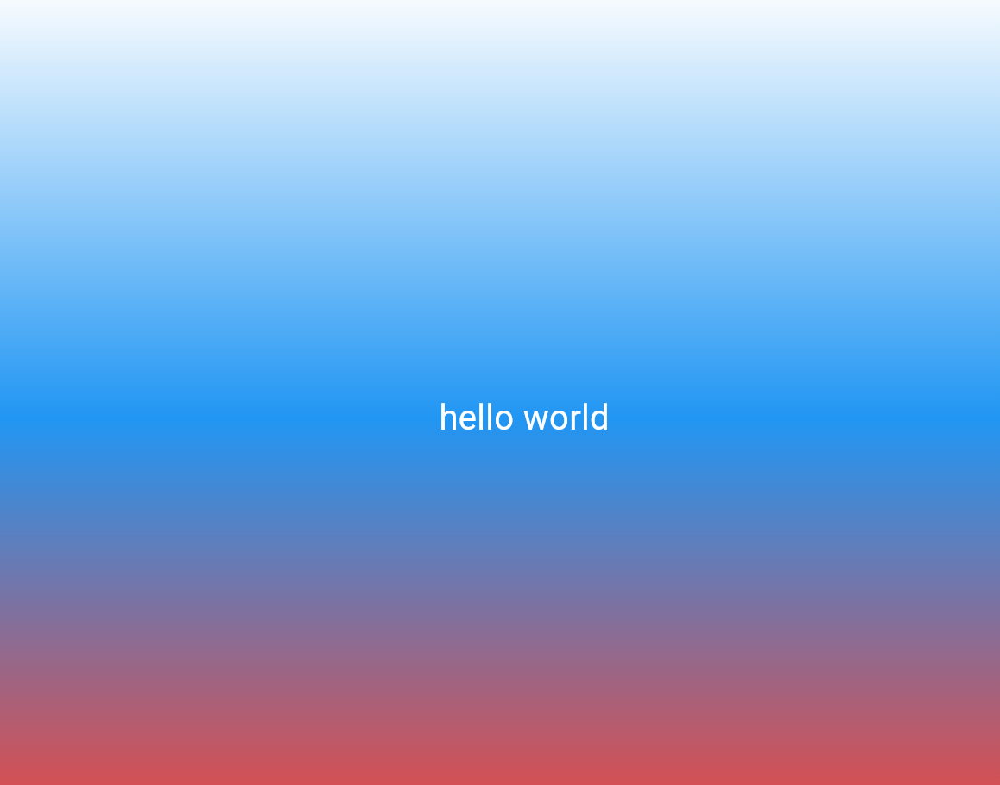

# first_app_ulianov
Учебный проект по лабораторной работе №3: знакомство с Flutter,
виджетами и деревом виджетов. Приложение выводит hello world
на градиентном фоне.

## автор
Ульянов Владислав
Исп-243

## стек и версии
- Flutter 3.47.2 (stable)
- Dart 3.13.2
- Платформа: Web (edge)
- IDE: VS Code

## скриншот

## запуск
1) перейти в папку с программой{cd first_app_ulianov}
2) запустить в vs code{code .}
3) при полной заргузке кода прейти в папку Lib в файл main.dart
4) нажать ctrl+f5 или f5 или run выше функции main

## что изучили
- базовые виджеты
- измененеие цвета фона, текста, а также его размера.
- инструменты
